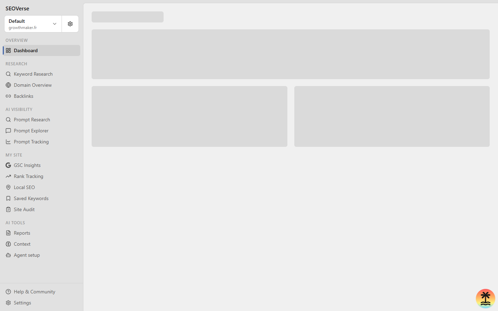

# SEOVerse

> **The developer-first, open-source alternative to Semrush and Ahrefs.**  
> Built for engineers, founders, and autonomous AI coding agents.

[](LICENSE)
[](https://github.com/foverse/seoverse)
[](https://modelcontextprotocol.io)



SEOVerse is an all-in-one SEO and AI visibility platform that puts you in complete control. Avoid expensive recurring SaaS subscriptions and bloated dashboards: run your SEO suite locally, self-host on your own infrastructure, and let autonomous AI coding agents perform deep keyword discovery, competitor gap analyses, and site audits via the Model Context Protocol (MCP).

---

## Features

- **Keyword Research and Clustering**: Discover search volumes, keyword difficulty, CPC, intent classification, and long-tail query clusters.
- **Full-Spectrum Site Audits**: Crawl technical issues, mobile readiness, performance bottlenecks, and canonical tag structure with prioritized fix recommendations.
- **Competitor Intelligence**: Map competitors' organic footprints, uncover ranking gaps, and analyze backlinks side-by-side.
- **Generative Engine Optimization (GEO)**: Track how often your brand is cited or mentioned across conversational AI models (ChatGPT, Perplexity, Gemini).
- **Rank Tracking and Local SEO**: Track organic rankings and Google Business Profile local pack visibility by location.
- **12 Built-in Agent Skills**: Modular workflows designed for Claude Code, Cursor, Antigravity, OpenClaw, and Hermes.
- **Private and Self-Hostable**: Runs locally with SQLite and D1 out of the box, or deploys to Cloudflare Workers or Docker.

---

## 12 Included AI Agent Skills

SEOVerse includes 12 production-ready skills located in [`.agents/skills/`](./.agents/skills) and [`plugins/openseo/skills/`](./plugins/openseo/skills) that AI coding assistants can run autonomously:

| Skill | Description |
| :--- | :--- |
| **`seo-audit`** | Audit a website, investigate real search opportunities, and deliver a data-backed prioritized report. |
| **`keyword-research`** | Discover keyword opportunities, analyze SERPs, CPC, difficulty, and search intent. |
| **`competitor-analysis`** | Analyze a competitor's organic footprint, ranking keywords, content themes, and backlink gaps. |
| **`keyword-clustering`** | Cluster keyword groups by search intent and map them into content hubs. |
| **`link-prospecting`** | Find link prospects, discover contact paths, and draft outreach from backlink signals. |
| **`local-seo`** | Audit Google Business Profiles, compare local competitors, and map local pack rankings. |
| **`seo-coach`** | Interactive SEO strategy assistant that prioritizes quick wins vs. long-term bets. |
| **`seo-report`** | Formats and outputs comprehensive executive SEO reports in self-contained markdown or HTML. |
| **`seo-project-setup`** | Configures site scope, competitor benchmarks, seed keywords, and initial baselines. |
| **`ai-visibility-audit`** | Audits brand mentions and citations inside ChatGPT, Gemini, and Google AI answers. |
| **`ai-prompt-research`** | Mines questions and search prompts people ask AI models about your niche. |
| **`competitive-landscape`** | Macro-level benchmarking comparing organic visibility across an entire industry landscape. |

---

## Quickstart (Run Fully Locally)

### Prerequisites
- Node.js 20+
- `pnpm` (Corepack or `npm i -g pnpm`)

### 1. Clone and Install
```bash
git clone https://github.com/foverse/seoverse.git
cd seoverse
pnpm install
```

### 2. Configure Environment
Create `.env.local`:
```bash
cp .env.example .env.local
```
Set `AUTH_MODE=local_noauth` for local development without external auth dependencies:
```env
AUTH_MODE=local_noauth
PORT=3001
DATAFORSEO_API_KEY=your_key_here # Optional: required for live Google SERP and backlink data
```

### 3. Migrate Local Database and Build Widgets
```bash
pnpm run db:migrate:local
pnpm run build:report-widgets
```

### 4. Start the Application
```bash
pnpm run dev
```
Open **`http://localhost:3001`** in your browser.

---

## Connecting with AI Coding Agents (MCP)

SEOVerse includes Model Context Protocol (MCP) configuration in [`.mcp.json`](./.mcp.json).

```json
{
  "mcpServers": {
    "openseo": {
      "type": "http",
      "url": "https://app.openseo.so/mcp"
    }
  }
}
```

Point Cursor, Claude Code, Antigravity, or Codex to this MCP server or run the local API server to allow your agent to execute audits, fetch rankings, and cluster keywords directly from your chat prompt.

---

## Self-Hosting

SEOVerse can be deployed in production without subscriptions:

- **Docker Compose**: Run on any VPS (Coolify, Dokploy, Portainer, or pure Docker). See [`docs/SELF_HOSTING_DOCKER.md`](./docs/SELF_HOSTING_DOCKER.md).
- **Cloudflare Workers**: Zero-maintenance serverless hosting on Cloudflare's free or paid tier. See [`docs/SELF_HOSTING_CLOUDFLARE.md`](./docs/SELF_HOSTING_CLOUDFLARE.md).

---

## Legacy Toolkit

The original lightweight offline single-file on-page analyzer and Stageshow demo are preserved in [`legacy-toolkit/`](./legacy-toolkit) and on the `backup/seo-toolkit` git branch.

---

## License and Attribution

- Released under the [MIT License](LICENSE).
- Built on top of the open-source OpenSEO engine by Every App.
